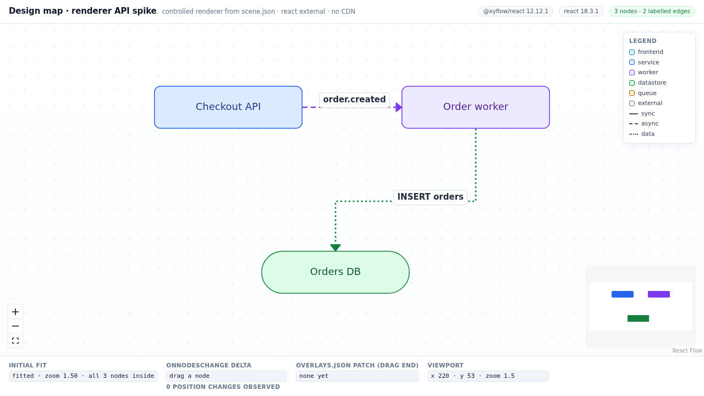
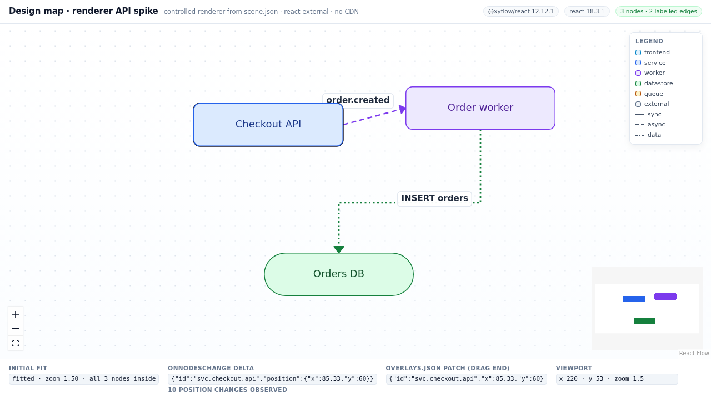
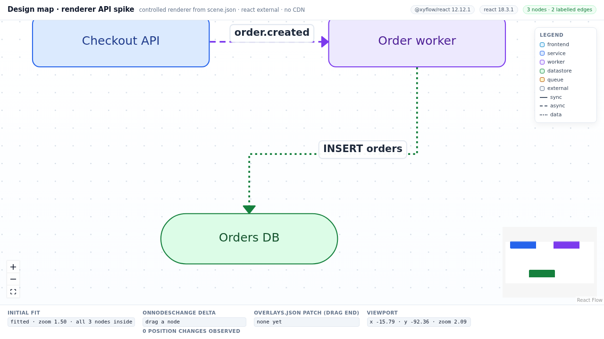

# Renderer API tests — @xyflow/react 12.12.1 in a DSH client panel

Fetch-first gate for designmap M1 (spec §12 / FR-10: every external API confirmed by an
executable API test before feature code). Written 2026-11-16 by UX/UI. The spike lives in
[`scripts/designmap-render-spike/`](../../scripts/designmap-render-spike/) and is the only
product code this gate produced.

## Verdict

**React Flow is feasible.** `@xyflow/react@12.12.1` bundles with esbuild 0.25.12 into a
harness client-module factory (`react` external), loads without a CDN through the **real**
`@deepseek-ai/dsh-client-modules` loader, and behaves as a controlled renderer: 3 nodes +
2 labelled edges from a scene JSON, initial fit, one-node drag emitting
`{"id":"svc.checkout.api","position":{"x":85.33,"y":60}}`, wheel zoom and drag pan.

The M1 blockers are **not** loading or rendering. They are three integration decisions:

1. **Bundle it, never declare it external.** `@xyflow/react` is not a seed word and not a
   DSH client package, so `dsh.client.external` cannot provide it. The bundle must carry it:
   **407.2 KiB raw, 213.2 KiB minified, 67.3 KiB gzip** (React Flow alone: 189.6 KiB
   minified / 62.9 KiB gzip).
2. **Scene points vs React Flow routing.** React Flow's built-in edges route between handles;
   the scene contract forbids re-routing. A custom edge drawing `edges[].points` and anchoring
   the label at `labelAt` works (proven) — M1 must implement it, and offset incident endpoints
   during a drag as a local preview.
3. **Overlay writes need a host command.** `remote.workspaceFiles` is read-only ("this service
   exposes no mutations"); the existing `/design-map` command accepts only
   `read | save | remove | layout`. M1 must extend that command (or add one) for
   `overlays.json` — that is host work, not client work.

React available to client factories is **18.3.1**, measured, not the `^18.2.0` package.json
claim and not React 19.

## Environment

| thing | value | how |
|---|---|---|
| Node | v24.20.0 | `node -v` |
| pnpm / npm | 10.18.0 / 11.19.0 | `pnpm -v`, `npm -v` |
| esbuild | 0.25.12 | `./node_modules/.bin/esbuild --version` |
| react / react-dom | 18.3.1 | `npm ls --depth=0` in the spike |
| @xyflow/react | 12.12.1 (MIT, peer `react >=17`) | `npm view @xyflow/react version peerDependencies` |
| browser | Chromium via Playwright MCP | `browser_navigate` |
| spike server | `http://127.0.0.1:4319/` | `node serve.mjs` |
| live client | `http://127.0.0.1:3080` (read-only) | see A1 |

The spike runs the **real** loader: `public/vendor/dsh-client-modules.client.js` is a byte
copy of
`/home/iustimov/.npm/node/lib/node_modules/@deepseek-ai/dsh/node_modules/@deepseek-ai/dsh-client-modules/lib/client.js`
(sha256 `fc491b97b5d923446faf9ebff238dba6d1f8a55b03e8bf71bea90355ee33bec6`, 25,831 B).
The page installs the same queue facade the DSH index installs, loads the real modules
bundle, calls `createClientModuleSystem`, and imports the spike row. Only the seed table
(React 18.3.1) and the boot graph row are supplied by the spike.

## A1 — React version handed to client factories: 18.3.1 (measured)

The live :3080 index requires the process launch token, so a fresh browser gets
`401 dsh web authentication required; reopen the URL printed by dsh web.` Static assets are
served unauthenticated. I measured the exact bytes the running server serves, in the browser
at :3080, and then executed the loader locally with the same React.

Command (Playwright MCP `browser_evaluate`, page at `http://127.0.0.1:3080/`):

```js
const response = await fetch('/assets/index-Ciz7DZxv.js', { cache: 'no-store' })
const text = await response.text()
// …
```

Observed:

```
status 200
bytes  1093870
sha256 65411dabad4de33466b12643cf30376d3d41ea1b7ce10ce329e97c89992d308b
around: …useSyncExternalStore(j,H,ze)…Ae.version="18.3.1",Ae}var Qm;…
static table: react:rS,"react/jsx-runtime":aS,"react-dom":fS,"react-dom/client":mS,
              "@deepseek-ai/cordis":jC,zod:tN,"@tanstack/react-virtual":cN,
              "@deepseek-ai/dsh-client-store":NN,"@deepseek-ai/dsh-client-ui-slots":RN,
              "@deepseek-ai/dsh-client-ui-primitives":DK,"@deepseek-ai/dsh-client-ui-dockkit":FJ
react binding: const nS=qa(x),rS=Qu(  // rS is the namespace built from that React
```

The browser-computed sha256 equals `sha256sum` of the installed
`@deepseek-ai/dsh-web-frontend/dist/assets/index-Ciz7DZxv.js`
(`65411dabad4de33466b12643cf30376d3d41ea1b7ce10ce329e97c89992d308b`), so the measurement is
of the bytes :3080 actually serves, not of a different build.

Then, inside the spike's factory, `require('react').version` is measured through the real
loader's `require`:

```js
window.__SPIKE_FACTORY_PROBE__ = { reactVersion: React.version, … }
// {"id":"@spike/designmap-render","reactVersion":"18.3.1","hasReactDefault":true,
//  "xyflowBundled":true,"sceneNodes":3}
window.__SPIKE_LOADER__.seed.get('react').version // "18.3.1"
[...window.__SPIKE_LOADER__.seed.keys()] // react, react-dom, react-dom/client, react/jsx-runtime
```

**The ONE fact that changes the M1 plan:** the panel is a React **18.3.1** surface. Do not use
React 19-only APIs (`use`, ref-as-prop, `<Context>` as provider, cleanup-function refs).
`react`, `react/jsx-runtime`, `react-dom`, `react-dom/client` are the four seed words a panel
may import; everything else must be bundled.

**Unverified:** I could not drive the authenticated :3080 shell itself (no launch token in this
session); the measurement is the served shell bytes + the real loader in the spike. See
§Unverified.

## A2 — Harness bundle format with esbuild: proven

Build command (from `scripts/designmap-render-spike/`):

```
node build.mjs
```

which runs esbuild 0.25.12 with:

```
entryPoints: src/panel.jsx, bundle: true, format: 'cjs', platform: 'browser',
target: ['chrome120'], external: ['react','react-dom','react-dom/client','react/jsx-runtime'],
loader: { '.css': 'text', '.js': 'jsx' }, jsx: 'automatic', jsxImportSource: 'react',
define: { 'process.env.NODE_ENV': '"production"' }
```

and wraps the CJS output in the harness registration (this is the whole trick):

```js
window.__ModuleLoader__.load({
  id: "@spike/designmap-render",
  factory(require) {
    …esbuild CJS body; its require("react") resolves through the loader seed…
  },
});
```

Observed (`node build.mjs`, exit 0):

```
esbuild 0.25.12
@xyflow/react 12.12.1 · react 18.3.1
client.js       407.2 KiB (CJS body 407.0 KiB)
client.bare.js  20.6 KiB (negative control: @xyflow/react external)
minified        213.2 KiB · gzip 67.3 KiB
seed.js         251.9 KiB
dsh client-mod  25.2 KiB sha256 fc491b97b5d92344…
```

Measured load in Chromium: `window.__SPIKE_IMPORT_OK__ === true`, console **0 messages**
(debug level), network only `127.0.0.1:4319`:

```
GET / 200 · GET /seed.js 200 · GET /vendor/dsh-client-modules.client.js 200
GET /bundle/client.js?rev=spike-1 200 · GET /boot.js 200
```

**The ONE fact:** a bare `import '@xyflow/react'` does **not** survive. `dsh.client.external`
only declares ordering edges to seed words / other client package rows; it cannot map an npm
package. See A3 for the observed refusal. M1 ships React Flow inside its `client.js`; no CDN,
no asset URL, no `client.*.js` chunk is needed for it.

**Unverified:** package-local chunk loading (`client.<name>.js` via `require.async`) was not
exercised; the route exists (`CLIENT_CHUNK = /^client\.[A-Za-z0-9][A-Za-z0-9._-]*\.js$/`,
served at `/plugins/<pkg>/<file>?rev=<rev>`), but bundling is simpler and smaller than a
second request.

## A3 — Negative control: bare external is refused at materialization

`/bare.html` loads the same panel built with `@xyflow/react` external. Command: navigate to
`http://127.0.0.1:4319/bare.html`, read `window.__SPIKE_ERROR__`. Observed:

```
Error: client-modules: require("@xyflow/react") missed the module table — not a platform seed
word, not a materialized module, and no registered package factory (a build-time externals
drift, or a dynamic dependency that did not arrive)
    at require (…/vendor/dsh-client-modules.client.js:2:20146)
    at Object.factory (…/bundle/client.bare.js?rev=spike-1:31:21)
    at ClientModuleSystem.materialize (…)
```

**The ONE fact:** even adding `"external": ["@xyflow/react"]` to `dsh.client` would not help —
`parseDshClient` accepts it as string metadata, `orderByModuleGraph` only reorders rows it
already has, and the runtime `require` still misses the table
(`dsh-client-modules/src/client/system.ts:328-339`). Bundle it.

## A4 — Controlled render from scene JSON: 3 nodes, 2 labelled edges

`src/scene.json` is contract-shaped (`x/y/w/h`, `points`, `labelAt`, `stale`, `type`). The
panel maps it to React Flow nodes with fixed `width/height` and `ariaLabel`, and to custom
`scene` edges. Observed (`window.__SPIKE_TEST__`):

```json
{"nodes":[
 {"id":"svc.checkout.api","x":40,"y":40,"w":180,"h":52},
 {"id":"svc.checkout.worker","x":340,"y":40,"w":180,"h":52},
 {"id":"db.orders","x":170,"y":240,"w":180,"h":52}],
 "edges":[
 {"id":"e.api.worker","source":"svc.checkout.api","target":"svc.checkout.worker","label":"order.created","type":"scene"},
 {"id":"e.worker.db","source":"svc.checkout.worker","target":"db.orders","label":"INSERT orders","type":"scene"}]}
```



**The ONE fact:** React Flow's built-in edges route between handles and cannot honour the
scene's fixed `points`. A custom edge (`BaseEdge` with the polyline + `EdgeLabelRenderer` at
`labelAt`) preserves core's geometry and still lets the human drag; M1 should adopt that shape
rather than `type: 'smoothstep'`.

## A5 — Initial fit: measured, all nodes inside

`fitView` (padding 0.25, `maxZoom` 1.5) + a post-paint `fitView` in `onInit`:

```json
{"viewport":{"x":220,"y":53,"zoom":1.5},
 "pane":{"width":1280,"height":604.42},
 "nodeRects":[
  {"id":"svc.checkout.api","left":280,"top":113,"right":550,"bottom":191},
  {"id":"svc.checkout.worker","left":730,"top":113,"right":1000,"bottom":191},
  {"id":"db.orders","left":475,"top":413,"right":745,"bottom":491}],
 "allInside":true}
```

**The ONE fact:** fitting works with the node dimensions supplied by scene `w/h` (no measured
DOM needed), so M1 can fit deterministically before fonts load. The fit zoom is
`min(pane/fit-box)`; cap it with `fitViewOptions.maxZoom` or a sparse 3-node scene fills the
pane at 2× (the first run without a cap did exactly that).

## A6 — Drag one node: only that node moves; the delta is an overlays patch

Playwright drag of `svc.checkout.api` by 76×34 screen px at zoom 1.5, then read the bridge.
Before: `(40,40)`, `(340,40)`, `(170,240)`. After:

```json
[{"id":"svc.checkout.api","x":85.33,"y":60,"selected":true},
 {"id":"svc.checkout.worker","x":340,"y":40,"selected":false},
 {"id":"db.orders","x":170,"y":240,"selected":false}]
```

The emitted `onNodesChange` delta (last of 10 changes in one drag, `dragging:false`):

```json
{"id":"svc.checkout.api","position":{"x":85.33,"y":60}}
```

Converted to the `overlays.json` row the renderer would send to the host:

```json
{"id":"svc.checkout.api","x":85.33,"y":60}
```



**The ONE fact:** React Flow node `position` is already in scene coordinates, so the overlay
patch is `{id, x, y}` with no transform — provided M1 never uses `nodeOrigin`/parent nodes
(unverified). `onNodesChange` fires per pointer step (10 for one drag), so the 500 ms overlay
debounce from the contract is mandatory.

## A7 — Pan and zoom: both work with core props

Wheel `-240` over the pane, then drag-pan 70×45 px on empty canvas:

```
before  {x:220, y:53, zoom:1.5}
zoom    {x:54.21, y:-47.36, zoom:2.0921}   // wheel
pan     {x:-15.79, y:-92.36, zoom:2.0921}  // drag on pane
```



**The ONE fact:** `panOnDrag` and `zoomOnScroll` are defaults; no plugin, no custom handler.
`Controls`, `Background`, `MiniMap` and `Panel` are exported by `@xyflow/react` itself
(`dist/esm/index.d.ts`: `additional-components/{MiniMap,Controls,Background}.d.ts`, `Panel`).
The **legend is not a built-in**: this spike builds it with the core `Panel` component — no
extra package. `MiniMap` is `<svg role="img"><title>Mini Map</title></svg>`; it is decorative
and should be labelled or `aria-hidden` deliberately in M1.

## A8 — Can the panel talk to the host? Yes, but not to write files

Client factories are not sandboxed: the factory runs in the page and (as a Cordis plugin)
receives `ctx` with the same services as any other client plugin. The existing
`plugins/design-map/client.js` is exactly this shape and uses:

```js
return {
  inject: ['slots', 'remote', 'remote.workspaceFiles', 'remote.commands', 'layout'],
  apply(ctx) { … ctx.remote.workspaceFiles.read(sessionId, FILE, {offset, limit}, signal) … }
}
```

Exact installed signatures (generated client faces):

- `remote.commands.execute(agentId: SessionId, line: string, submittedAttachments: readonly
  CommandSubmitAttachment[], signal?: AbortSignal) => Promise<RemoteResult<CommandExecution | undefined>>`
  — `@deepseek-ai/dsh-commands/lib/typert.remote-client.d.ts`
- `remote.workspaceFiles.read(workspaceFileScopeId: SessionId, path: string, range:
  WorkspaceFileRange, signal?: AbortSignal) => Promise<RemoteResult<WorkspaceFileText>>`
  plus `stat`, `list`, `search`, `changes` —
  `@deepseek-ai/dsh-api-workspace-files/lib/typert.remote-client.d.ts`

`dsh-api-workspace-files/lib/types/index.d.ts` is explicit: *"this service exposes no
mutations."* The design-map plugin writes by sending a slash command
(`remote.commands.execute(sessionId, '/design-map {…}', [])`), and the host command currently
accepts only `read | save | remove | layout`
(`plugins/design-map/index.js:1292-1309`).

**The ONE fact:** overlay writes have **no existing client API and no existing command op**.
M1 cannot ship `nodeMoved → overlays.json` without a host change: extend `/design-map` with an
`overlay` op (validate against the contract) or add a dedicated command. That is BACKEND work
and must be scheduled before the panel claims persistence.

**Unverified:** the spike itself has no Cordis context (it is a static page), so it proves the
bundle format, not a live `ctx.remote` call; the existing plugin is the live evidence for that
path.

## A9 — Console, network, accessibility

Console during the spike: **0 messages** (Playwright `browser_console_messages`, level debug,
after load + drag + pan/zoom). The favicon is a data URI, so there is no 404.

Network: 5 requests, all `127.0.0.1:4319` (A2) — no CDN, no font fetch, no asset URL.

Accessibility (axe-core 4.14 via `@axe-core/playwright`, real Chromium):

```
violations: []
passes: 38
incomplete: aria-prohibited-attr, color-contrast (SVG/overlap heuristics)
consoleErrors: []
```

Tab order: edges (`role=group`, names "order.created (async edge from …)"), then nodes
(`role=group`, names "Checkout API (service)" etc.), then Controls buttons ("Zoom In", "Zoom
Out", "Fit View"), then the React Flow attribution link. Node names come from the `ariaLabel`
set from scene labels; edges from `ariaLabel` built from the scene.

**The ONE fact:** React Flow v12 makes nodes focusable and named but does **not** move them
from the keyboard (ArrowRight/ArrowLeft emitted no delta). M1 owns keyboard parity for a
drag-only editing action: arrow-key nudge + a visible affordance, or an equivalent non-drag
control. Colour contrast was "incomplete" only because axe cannot resolve the gradient
background; manual values: node ink `#1e3a8a` on `#dbeafe` ≈ 8.5:1, footer `#475569` on
`#ffffff` ≈ 7.6:1.

## Exact recipe for M1

1. Add `@xyflow/react@12.12.1` to the panel package. It must be in `dependencies` of the
   bundle build, not in `dsh.client.external`.
2. Build the panel with esbuild (`format: 'cjs'`, `platform: 'browser'`,
   `external: ['react','react-dom','react-dom/client','react/jsx-runtime']`,
   `loader: { '.css': 'text' }`, `define: { 'process.env.NODE_ENV': '"production"' }`).
3. Wrap the CJS body:
   `window.__ModuleLoader__.load({ id: PKG, factory(require) { …body… } })`.
   The injected `require` resolves the four React seed words; everything else is already in
   the body.
4. Inline `@xyflow/react/dist/style.css` as a text import and inject one `<style>` from the
   factory (the spike does this; 18.2 KiB raw, part of the 213.2 KiB minified bundle).
5. Map scene → nodes (`width/height` from `w/h`, `ariaLabel` from label+type, `draggable`),
   keep `onNodesChange` → `applyNodeChanges`, and emit `{id, position}` to the host on drag
   (debounced). Map scene → **custom edge** using `edges[].points` + `labelAt`; do not use
   built-in routed edges if the contract's geometry is binding.
6. Do not add `nodeOrigin`/parent nodes without re-checking the delta (position → overlays
   x/y is only identity in the spike's flat coordinate space).
7. Host work: an overlay-write command/op is required (A8).
8. Keyboard: add arrow-key movement and a focus/selection affordance (A9).

## What stayed unverified

- The authenticated :3080 shell page: no launch token in this session (401). Measured the
  exact served bundle + the real loader locally instead.
- A live `ctx.remote` call from a mounted panel — needs the plugin installed (non-scope).
- The overlay-write command: does not exist yet.
- Package-local dynamic chunks (`require.async('./client.x.js')`) and the
  `/plugins/<pkg>/<file>?rev=` route.
- React Flow at 25-node scale (NFR-3), custom node shapes (ellipse/diamond for
  datastore/decision), touch input, Firefox/Safari, and HMR/panel registration.
- `nodeOrigin`/sub-flow coordinate semantics; the spike has a flat scene only.
- Pixel-diff baselines.

## Reproduce

```bash
cd scripts/designmap-render-spike
npm install                      # added 27 packages; esbuild 0.25.12, react 18.3.1, @xyflow/react 12.12.1
node build.mjs                   # exit 0, sizes above
node serve.mjs                   # http://127.0.0.1:4319/
# then: open / for the spike, /bare.html for the negative control
```

Screenshots: [`render-spike-initial.png`](screenshots/render-spike-initial.png),
[`render-spike-after-drag.png`](screenshots/render-spike-after-drag.png),
[`render-spike-zoom-pan.png`](screenshots/render-spike-zoom-pan.png).
