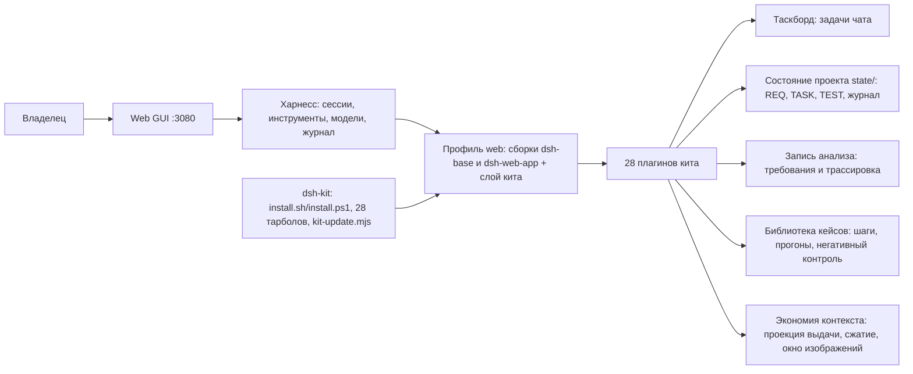

> **Историческая запись (design-map v1).** v1 удалён в P3 2026-11-24: файлы модели, сцена-контракт и семь инструментов `designmap_*` больше не существуют; имена ниже — история, не инструкция. Актуальное описание — `docs/DESIGNMAP-V2.md`.

# Архитектурное ревью харнесса dsh-kit — 2026-11-20

**Что ревьювали.** Рабочее дерево `/home/iustimov/dsh-kit` на 2026-11-20: 28 плагинов кита,
2 006-строчный слой профиля, ~50 скриптов, состояние проекта в `state/` (686 файлов). Харнесс —
`@deepseek-ai/dsh` 0.2.2-rc.3 (pre-1.0, ломающие изменения разрешены политикой; на npm уже
опубликован `0.2.2-rc.5`, `engines: node >= 24.9.0`). Запущенная копия — профиль `web` на
`http://127.0.0.1:3080`; она **отстаёт от дерева** (см. §4.3).

**Кто ревьювил.** Оркестратор этой сессии и три чтения специалистов: путь установки и
переносимость Linux/Windows, поддерживаемость кода, отказные режимы. Ни один файл продукта не
изменён, ни одна установка, сборка или перезапуск сервера не выполнялись. Размеры, версии и число
тестов сняты командами `wc`/`git log` в проходе по поддерживаемости; поведение продукта не
прогонялось ни разу.

**Как читать.** Каждое утверждение о поведении имеет источник: `файл:строка`, id задачи или
наблюдение в этой сессии. Где сказано «по коду» — это чтение исходника, а не прогон. Где сказано
«не проверено» — прогона не было и быть не могло: Windows-хоста в этой сессии нет. Словарь —
`docs/TERMINOLOGY.md`: «условие приёмки» вместо «гейт», «расхождение» вместо «дрифт».

---

## 1. Итог

Харнесс собран архитектурно правильно: upstream не форкается, кит — это слой настроек профиля и
набор плагинов, у каждого механизма есть проверка, а решения записаны рядом с кодом. По зрелости
это выше, чем у большинства персональных агентских сборок: единственный источник истины о наборе
плагинов (`plugins/inventory.json`), сверка «исходник ↔ упакованный тарбол», обязательный
негативный контроль у проверок, скрипт сходимости машины с китом (`scripts/kit-update.mjs`).

Слабое место — не качество отдельных частей, а **цена связности и слой, на котором доказывается
поведение**. Работа описывается четырьмя записями сразу (задача в таскборде, зеркало в `state/`,
трассировка в записи анализа, кейс), и каждая может отказать в закрытии. Проверки при этом часто
смотрят **ниже** контракта: полный текст проекции лежит на диске, но агент не может его прочитать
(§4.4); `make verify` не запускает ни одного теста и ни одного proof-скрипта (§3.2). А два места
вообще не имеют защиты от повторного запуска: задача с мёртвым ребёнком не закрывается и роль
считается занятой навсегда (§4.5), доска пишется двумя процессами без блокировки (§4.6).

| Ось | Оценка | Одной фразой |
|---|---|---|
| Поддерживаемость кода | 3 из 5 | модульность настоящая, но сложность сконцентрирована в четырёх больших файлах и в четырёх записях о работе |
| Стабильность работы | 3 из 5 | инварианты состояния сильные, но запущенная копия отстаёт, журналы сессий ещё не отремонтированы, а задача с мёртвым ребёнком не закрывается |
| Установка и обновление | 3 из 5 | Linux — предсказуемо; Windows — аккуратно написан, но ни разу не проверен, без обёртки и без отката |
| Повседневное использование | 4 из 5 | панели и состояние в чате экономят время; цена — 2 006 строк конфигурации и условия приёмки, которые иногда мешают закончить работу |

---

## 2. Карта системы

- **Харнесс не правится.** Кит добавляет строки в профиль и плагины рядом (`docs/HARNESS-OVERVIEW.md`:13).
  Это главное архитектурное решение, и оно верное: обновление upstream не требует слияния форка.
- **Работа описывается четырьмя записями.** Задача (`state/task/`), зеркало в таскборде, запись
  анализа с трассировкой требования и кейс с прогоном. У каждой свой формат, свой писатель и своё
  условие приёмки при закрытии.
- **Проверки двух видов, и они не пересекаются.** `make verify` — шесть статических проверок
  согласованности текстов и упаковки (`Makefile`:135-141); `make cases` — прогон сохранённых кейсов
  продуктовым раннером (`Makefile`:147-148). Плюс 20 proof-скриптов в `scripts/*-proof.mjs` и 51
  файл `plugins/*/test/*.test.mjs`, которые не запускаются ни одной целью (`make`).

---

## 3. Ось: поддерживаемость кода

### 3.1 Что сделано хорошо

- **Один источник истины о наборе.** `plugins/inventory.json` перечисляет 28 плагинов, и упаковка,
  монтирование и документация сверяются с ним (`plugins/inventory.json`:3). Добавить плагин «мимо
  списка» нельзя: `node scripts/check-portability.mjs` падает.
- **Сверка исходника и артефакта.** Проверка `tarball:matches-source` сравнивает содержимое тарбола
  с рабочим деревом; 2026-11-17 она поймала два реальных расхождения (`docs/HARNESS-OVERVIEW.md`:531-540).
  Это ровно тот класс ошибки («установка не воспроизводит дерево»), который иначе всплывает на
  чужой машине.
- **Негативный контроль как правило.** Большинство проверок умеет падать намеренно:
  `CASE_NEGATIVE_CONTROL=expect-pre-fix` встречается в 20 файлах, а прогон кейса в режиме `red`
  требует контрольного отказа и без него не засчитывает подтверждение
  (`plugins/test-cases/bin/cases.mjs`:113).
- **Сходимость вместо инструкции.** `scripts/kit-update.mjs` сравнивает содержимое по хешам, а не
  по версиям, умеет `--check`/`--apply`/`--json` и не трогает модель без нужды
  (`scripts/kit-update.mjs`:2-49).
- **Решения записаны рядом с кодом.** Слой профиля — 2 006 строк, из них ~700 — комментарии с
  измерениями и «почему так» (`profile/cordis.patch.yml`:5-55). Через полгода это дешевле, чем
  отдельный документ, который разойдётся с кодом.

### 3.2 Где менять дорого

1. **Четыре файла держат почти весь объём.** `plugins/orchestrator/orchestrator.mjs` — 94 899 байт /
   1 345 строк (текст политики 425–525 ≈ 19 КБ, тело `apply()` 709–1343 — 635 строк);
   `plugins/taskboard/taskboard.mjs` — 140 468 Б / 2 367 строк; `plugins/analysis/store.mjs` —
   101 596 Б / 1 986 строк; `plugins/test-cases/test-cases.mjs` — 1 071 строка. Правка абзаца
   политики требует переупаковки плагина, поднятия версии и перезапуска сервера.
2. **Слой профиля на 2 006 строк** — второй по концентрации. Он же дублирует обоснования из
   `README.md` и `rules/DEPLOYMENT.md`; при расхождении прав источник неочевиден.
3. **`make verify` не проверяет продукт.** Шесть целей — `check-portability`, `check-documentation`,
   `check-glossary`, `schema-lint`, `context-budget`, `harness-identity-guard` (`Makefile`:135-141).
   Ни одна не запускает 51 тест и 20 proof-скриптов; корневого `package.json` и раннера в ките нет,
   `test`-скрипт объявлен только в `plugins/designmap/package.json`:22. То есть «проверки проходят»
   не значит «поведение работает».
4. **Три проверки проходят при сломанном продукте** (чтение кода, не прогон):
   `scripts/context-budget.mjs` на машине без сессий даёт предупреждение и код 0;
   `scripts/schema-lint.mjs` обходит каталоги не рекурсивно (`:44-46`) и привязан к точным отступам
   YAML (`:63-74`) — отрефакторь слой, и он покажет «0 red» с кодом 0; `scripts/check-portability.mjs`:717
   считает плагин смонтированным по подстроке `id: …` во всём файле, включая комментарии.
5. **Дубли механизмов системные.** «Этому пресету можно этот инструмент» реализовано 6 раз
   (`outline.mjs`:436, `analysis.mjs`:66, `delegation-brief/index.mjs`:45, `designmap/index.js`:62,
   `diagrams/index.js`:36, `godot-mcp.mjs`:693); `normalizeConfig` — 9 копий; запуск процесса — 4
   разные обёртки с разными таймаутами; два своих парсера YAML (`project-state/lib/format.mjs`:142,
   `designmap/src/workspace.mjs`:57); два `renderBrief` (`orchestrator.mjs`:531,
   `delegation-brief/lib/brief.mjs`:61); безопасный путь и lossless-обёртка скопированы дословно из
   `diagrams` в `presentation`. Смена контракта `toolFamilies` правит 6 файлов, список ролей живёт в
   4 местах (код, `scripts/context-budget.mjs`:47, слой профиля, proof-скрипт).
6. **Обещание «единственный писатель» держится на дисциплине, а не на локе.**
   `regenerateViews` пишет `state/views/*` и `.hashes.json` вне `withLock`
   (`plugins/project-state/lib/core.mjs`:656-698), а вызывают его два независимых зеркала
   (`taskboard/mirror.mjs`, `analysis/mirror.mjs`). Прямых записей в `state/` мимо ядра нет — это
   хорошо; но проекции могут разойтись с содержимым.
7. **Плагины — это в том числе сгенерированные бандлы.** `designmap/client.frame.js` — 3,47 МБ
   вложенного бандла в репозитории; любое изменение схемы карты требует пересборки, а
   `schema-lint` описания его инструментов не видит.
8. **Четыре записи о работе расходятся с реальностью.** `TASK-242` (allow-список ролей) имеет
   `stepsDone: 4`, заполненные `resultEvidence` и `resultSummary`, но статус `review` и три
   незакрытых критерия приёмки (`state/task/TASK-242.md`:5, 24-29). `TASK-237` (ремонт журналов
   сессий) — `status: open`, `stepsDone: 0`, хотя исправление в коде и в запущенной копии уже есть
   (§4.2). Это не ложь, это стоимость четырёх учётных форм: их обновляют вручную и по-разному.
9. **Документы-снимки стареют молча.** `docs/HARNESS-OVERVIEW.md` (снимок 17.11) говорит «23
   плагина» (`:15`, `:167`) при 28 в инвентаре и описывает `notify` через `notify-send`
   (`README.md`:21), тогда как плагин уже рисует своё окно на Tk/WinForms
   (`plugins/notify/README.md`:9-18). Пины в `docs/SESSION-CONTEXT.md`:3 (`0.1.5-rc.1`) и
   `docs/CONTEXT-ECONOMY-DESIGN.md`:3 (`0.2.1-rc.2`) устарели, и `check-documentation` каталог
   `docs/` не читает вовсе. Один из пунктов обзора (§8.3, мёртвый `designRef`) уже исправлен —
   проверено сегодня: слой указывает на `designmap/manifest.json` (`profile/cordis.patch.yml`:159),
   у файла есть `rev: 32`, и проверка расхождения карты (`plugins/analysis/store.mjs`:1239-1242)
   теперь может сработать.
10. **Темп изменений высокий.** Версии в дереве: `taskboard` 0.1.68, `orchestrator` 0.1.63,
    `designmap` 0.1.25, панель состояния 0.1.46. Каждый выпуск требует перепаковки тарбола,
    поднятия версии и перезапуска, чтобы правка дошла до владельца. Upstream при этом ушёл вперёд:
    пин `0.2.2-rc.3`, опубликован `0.2.2-rc.5`.

---

## 4. Ось: стабильность работы

### 4.1 Инварианты, которые действительно держатся

Состояние проекта — самая крепкая часть системы: один писатель `state/`, типизированные
последовательные ID под каталогом-локом `state/.lock` (`mkdir` как O_EXCL, ожидание 3 с,
устаревание 10 с — `plugins/project-state/lib/core.mjs`:144-151), ссылки хранят sha256 цели,
переходы идут compare-and-set, журнал append-only. Параллельная правка панелью и инструментом не
превращается в «кто последний, тот и прав»: второй писатель получит отказ по ревизии. Контракт
«возвращает `{ok:false, code}`, не бросает» (`core.mjs`:9-11) — то, чего обычно не хватает.

Три оговорки, найденные при чтении ядра: сущность пишется прямо в файл, без temp+rename
(`core.mjs`:225-229), то есть обрыв процесса в момент записи оставит порванный файл; проекции
`state/views/*` пишутся вне блокировки (§3.2 п.6); журнал `events.jsonl` (2,2 МБ, ~1 160 строк)
перечитывается целиком на каждую запись (`core.mjs`:203-209). Последнее — цена, которая растёт с
историей: чем дольше живёт проект, тем дороже каждая запись.

### 4.2 Что уже сломалось и что осталось

**Инцидент `TASK-237`.** Плагин `state-feed` вставлял в сессию сообщение `user/message` без `id`;
загрузчик харнесса отказывает всей сессии («event at seq N lacks an identified message»), то есть
каждая корневая сессия, получившая вставку состояния, становилась незагружаемой
(`state/task/TASK-237.md`:17). Это худший класс отказа для персонального инструмента: не «функция
не работает», а «моя история не открывается».

- Исправление в коде есть: сообщение собирается с `id: randomUUID()` и объяснением, почему это
  обязательно (`plugins/state-feed/lib/feed.mjs`:107-120).
- В **запущенной** копии исправление тоже есть — проверено по установленному файлу
  `~/.npm/dsh/profiles/web/node_modules/@cc/dsh-state-feed/lib/feed.mjs`:120.
- Дополнительно к **самому харнессу** применён сторож `scripts/harness-identity-guard.mjs`: он
  переписывает отсутствующий `id` при записи и при загрузке (`--check` → exit 0, marks
  `import,write,load`). Это единственное место, где кит всё-таки правит установленный upstream —
  и потому этот сторож живёт ровно до следующего обновления харнесса: его переприменяет только
  `kit-update --apply`, а `start.sh` при неинтерактивном stdin загружается без обновления
  (`start.sh`:46-61). Обновление харнесса без `--apply` снимает защиту молча.
- А ремонт уже испорченных журналов — шаги 4-7 той же задачи — не сделан: `status: open`,
  `stepsDone: 0` (`state/task/TASK-237.md`:5, 14). Пока он не сделан, часть прошлых сессий
  остаётся нечитаемой, и это не видно ни в одной панели.

**Вывод:** механизм починен, последствия — нет. Ремонт данных должен быть отдельным проверяемым
шагом с бэкапом и идемпотентностью, иначе он не случится никогда.

### 4.3 Запущенная копия отстаёт от дерева

Сверка установленного профиля `~/.npm/dsh/profiles/web/package.json` с деревом на сегодня:

| Плагин | Установлено | В дереве |
|---|---|---|
| `@cc/dsh-orchestrator` | 0.1.62 | 0.1.63 |
| `@cc/dsh-taskboard` | 0.1.67 | 0.1.68 |
| `@cc/dsh-project-state-panel` | 0.1.45 | 0.1.46 |
| `@cc/dsh-diagrams` | 0.1.7 | 0.1.8 |
| `@cc/dsh-skills` | 0.1.16 | 0.1.17 |
| `@cc/dsh-tail-pruner` | **нет** | 0.1.0 |
| `@cc/dsh-presentation` | **нет** | 0.2.2 |

Следствия не косметические: в запущенной копии нет `tail-pruner` — плагина, который держит разрыв
кэша в хвосте контекста и по измерению кита сохраняет 96,6 % пересчёта свежих токенов
(`README.md`:12-19); и нет `presentation`. В слое профиля запущенной копии строк для них тоже нет
(`~/.npm/dsh/profiles/web/cordis.patch.yml`, поиск `tail-pruner|presentation` — пусто).

Это не дефект кода: `start.sh`/`start.ps1` умеют замечать расхождение и предлагают применить
(`start.sh`:46-63). Это дефект привычки: сервер живёт неделями, а сходимость происходит только при
перезапуске. Пока в интерфейсе нет отметки «профиль отстаёт на N выпусков», владелец не узнает, что
смотрит на другую систему, чем описана в репозитории.

Хуже: пять ссылок установленного профиля ведут на **удалённые** тарболы
(`cc-dsh-diagrams-0.1.7`, `cc-dsh-orchestrator-0.1.62`, `cc-dsh-project-state-panel-0.1.45`,
`cc-dsh-skills-0.1.16`, `cc-dsh-taskboard-0.1.67`). Рантайм работает на уже распакованных копиях, но
любая переустановка из профиля без `kit-update --apply` упадёт на `file:`-путях. И установленный
`orchestrator` 0.1.62 не знает роли `PRESENTER`, которая есть в дереве, — то есть часть описанных
возможностей на этой машине просто отсутствует.

### 4.4 Проверка, которая доказывает не тот слой: проекция выдачи

Проекция выдачи — короткая замена большого результата инструмента: голова, хвост и путь к полному
тексту (`plugins/run-code-projection/run-code-projection.mjs`:104-112, 202-224). Замысел: контекст
не забивается, а полный текст всегда доступен по пути из баннера.

Наблюдение в этой сессии: это верно до 8 КиБ. `read` входит в список проецируемых инструментов
(`:87-91`), порог — 8 192 байта (`:106`). Файл на 53 КБ приходит баннером и путём к спиллу; но
чтение самого спилла — снова `read` на 53 КБ, и он **снова проецируется**. Середина файла
недостижима: агент видит голову и хвост головы и хвоста. Обойти можно только чтением окнами меньше
8 КиБ по номерам строк — то есть ровно тем способом, который кит в другом месте запрещает как
чтение вслепую.

Проверка плагина этого не ловит, потому что читает спилл с диска, а не через инструмент:
`readFileSync(bannerPath, …)` (`plugins/run-code-projection/proof/proof.mjs`:105, 131) — файл на
месте и совпадает побайтово, а путь агента сломан. Критерий приёмки `TASK-240` сформулирован верно
(«полный текст читается по этому пути», `state/task/TASK-240.md`:10) — но доказан ниже уровня, на
котором ломается.

Это тот же класс, что и §4.2: **проверка честная, но проверяет не то место.** Для ревью это
главный вывод по стабильности: сила кита — в проверках, и именно поэтому слабое место — проверки,
которые смотрят на слой ниже контракта.

### 4.5 Жизненный цикл дочерних сессий

Дефект 2026-11-12 («закрытие первой задачи убивало работу второй») закрыт лизингом: `linkChild`
передаёт ребёнка от задачи-донора к новой, у донора ребёнок исчезает, а закрытие прерывает только
тех детей, чей лизинг у этой задачи (`plugins/taskboard/taskboard.mjs`:743-768, 1307-1341). Это
хорошее решение — но у него есть две незакрытые стороны.

1. **Задача-донор остаётся `active` без ребёнка.** Статус донора при передаче не меняется
   (`taskboard.mjs`:1307-1341), а отчёт о долге считает только `review` и `ready`
   (`plugins/orchestrator/orchestrator.mjs`:71-73). Такая задача невидима: она не в работе и не в
   очереди, её просто нет.
2. **Мёртвый ребёнок блокирует приёмку.** `subagent/end` приходит только в живом процессе
   (`taskboard.mjs`:2026-2028). После рестарта сервера задача остаётся `active`, роль считается
   занятой (`orchestrator.mjs`:614-626), а `task_close` отказывает `interrupt_failed`
   (`taskboard.mjs`:856-857). Флаг `force` есть только у `task_cancel` (`:822-828`), то есть
   единственный выход — отменить задачу и потерять приёмку. Сверка таких задач при старте не
   автоматическая: `scripts/taskboard-migrate.mjs` умеет «осадить» активные задачи с
   завершившимися детьми, но запускается вручную.

Плюс сегодня это уже смягчено в другом месте: при занятой роли рантайм поднимает **новую** сессию, а
не кладёт второй бриф в занятую (ответ на второе делегирование в этой сессии: `reused: false`,
`roleNote` «a fresh session was started instead of queueing a second brief»).

### 4.6 Два процесса пишут доску

`.dsh/taskboard.json` (1,97 МБ) — один файл на воркспейс, запись полная, перезапись без
кросс-процессной блокировки; в шапке плагина это сказано прямо (`taskboard.mjs`:54-55, 471-472).
Второй сервер на том же воркспейсе, второй профиль или `scripts/taskboard-migrate.mjs` дают
«последний победил» — и потерянные задачи. Для инструмента, который живёт на трёх машинах и
нескольких чатах, это единственный незащищённый файл состояния.

### 4.7 Отказные режимы, сведённые в таблицу

| Режим | Причина | Что видит владелец | Где доказательство |
|---|---|---|---|
| Сессия не открывается | запись без `id` в журнале | «моя история пропала» | `state/task/TASK-237.md`:17 |
| Кит «сошёлся», но не сошёлся | на Windows нет обёртки; `null` вместо ошибки при отсутствии `tar`/`corepack` | функции молча деградируют | `install.ps1`:140; `scripts/kit-update.mjs`:184-195 |
| Сервер ломается после обновления | замена харнесса под живым сервером | «Failed to load plugins» | `scripts/kit-update.mjs`:528-531, 567-573 |
| Задача не закрывается | условия приёмки требуют доказательств, которых нет в записи | работа сделана, статус `review` | `state/task/TASK-242.md`:5-15 |
| Середина документа недоступна | проекция `read` > 8 КиБ и повторная проекция спилла | агент цитирует только голову/хвост | §4.4 |
| Задачу нельзя закрыть после рестарта | `subagent/end` не пришёл, ребёнок мёртв, `force` есть только у отмены | приходится отменять и терять приёмку | §4.5 п.2; `taskboard.mjs`:856-857, 822-828 |
| Задача-донор исчезла из виду | лизинг ребёнка передан, статус донора не изменён | задача не в работе и не в очереди | §4.5 п.1; `orchestrator.mjs`:71-73 |
| Доска и реестр состояния расходятся | зеркало вызывается без ожидания, при ошибке только `warn` | панель показывает старый статус | `taskboard.mjs`:1181, 1911-1924; `mirror.mjs`:140-152 |
| Второй процесс затирает доску | нет кросс-процессной блокировки, полная перезапись 1,97 МБ | потерянные задачи | §4.6; `taskboard.mjs`:54-55 |
| Порог компакции молча откатился | политика ищется по точной паре provider+model | окно 1M компактится на 800K вместо 524K и переоплачивает контекст | `profile/cordis.patch.yml`:1128-1143 |
| Роль получила лишние инструменты | плагин не спросил `toolFamilies.allows()`, пресет без строки получает всё | растёт цена контекста | `state/task/TASK-242.md`:31-32; `tool-families.mjs`:472-500 |
| Проверка проходит на пустом входе | нет сессий, нет отступов YAML, закомментированная строка | «всё проверено», хотя не проверено ничего | §3.2 п.4 |

---

## 5. Ось: установка и обновление на Linux и Windows

### 5.1 Как ставится

| Шаг | Linux (`install.sh`) | Windows (`install.ps1`) |
|---|---|---|
| Проверка Node | мажор ≥ 24 (`:29-38`) | мажор ≥ 24 (`:45-49`) |
| Пин харнесса `0.2.2-rc.3`, пользовательский npm-префикс | `:22`, `:43-52` | `:76-95`; сравнение префикса без учёта регистра и с границей каталога — измерено под PowerShell 5.1 |
| Профиль `$DSH_HOME/profiles/web` | копия с предупреждением, если файл отличается (`:63-68`) | копия с `-Force`, без предупреждения (`:100-102`) |
| 28 плагинов | `corepack pnpm@11.7.0 add plugins/*.tgz` (`:77`) | то же списком файлов (`:108`) |
| `DEPLOYMENT.md` в `$DSH_HOME` | `:83` | `:117` |
| Внешние инструменты (RTK, Marp, Mermaid, D2) | `provision-tools --apply`, best-effort (`:89-94`) | то же; POSIX-установщики отклоняются, называется эквивалент для winget/choco (`:124-135`) |
| Обёртка `$DSH_HOME/bin/dsh`, которая сходится с китом при каждом запуске | есть (`scripts/dsh-wrapper.sh`:32) | **нет**; аналога `dsh-wrapper.ps1` не существует |

Windows-установщик написан не «на всякий случай», а по измеренным граблям: сторож `Assert-Step` на
каждый обязательный внешний вызов, потому что PowerShell не считает ненулевой код возврата ошибкой
(`install.ps1`:24-40); файл держится ASCII, потому что UTF-8 без BOM ломает разбор под PowerShell 5.1
(`:54-62`). Это сильная сторона — но проверенная только чтением кода.

### 5.2 Откат не реализован

В `scripts/kit-update.mjs` нет ни `--rollback`, ни `--to <commit>` (`:96-131` — исчерпывающий список
флагов). `.dsh-kit-state.json` — запись о том, что применено, а не снимок прежних файлов
(`:403-412`). `rules/DEPLOYMENT.md` §3 описывает только движение вперёд. `USERGUIDE.md`:483
отсылает к «бэкапу до апгрейда», которого ни один шаг не снимает.

Фактический откат сегодня — вручную: вернуть кит на прежний коммит (`git -C <kit> checkout …`) и
повторить `--apply`. Ни в одном документе эта процедура не описана и никем не проверялась.

### 5.3 Пять рисков установки, по убыванию

1. **Windows: обновление под живым сервером ничем не защищено.** Сторож «`dsh web` уже запущен»
   читает `/proc` и на не-Linux возвращает `null` (`scripts/kit-update.mjs`:533-545, 567-573), а
   `start.ps1` не проверяет сервер вовсе (`:58-89`). При этом на Windows нет обёртки, то есть
   сходимость случается именно тогда, когда сервер, скорее всего, работает. Измеренное последствие
   описано самим китом: «Failed to load plugins», пока сервер не перезапустят
   (`scripts/kit-update.mjs`:528-531).
2. **Нет отката** (§5.2) — при том что обновление трогает и харнесс, и 28 плагинов, и слой профиля.
3. **`install.ps1` затирает машинный `cordis.patch.yml`** молча (`:100`), тогда как Linux-установщик
   сохраняет отличающуюся версию и предупреждает (`install.sh`:63-68). Это единственный шаг, где две
   платформы расходятся по смыслу, а не по синтаксису.
4. **Windows-провижининг внешних инструментов не проверен и местами неверен по коду:** движок
   `impeccable` ставится из `@impeccable/cli-linux-x64` на любой платформе
   (`scripts/provision-tools.mjs`:1001-1007), поэтому на Windows не сможет стать `ok`; `godot.exe`
   не попадает в PATH (`scripts/provision-godot.mjs`:273-281); сам кит помечает Windows-путь как
   непроверенный (`scripts/provision-godot.mjs`:62-66, `USERGUIDE.md`:363-365).
5. **Скрытые требования к машине** обнаруживаются только на сбое. Установщик проверяет мажор Node,
   а харнесс требует `>= 24.9.0` (npm, `engines`), то есть Node 24.0–24.8 проходит проверку кита и
   падает при старте харнесса. Обёртка жёстко берёт Node из `$HOME/.npm/node/bin/node`
   (`scripts/dsh-wrapper.sh`:22), сходимость ждёт `corepack.js` рядом с интерпретатором
   (`scripts/kit-update.mjs`:173-177), распаковка требует `tar` (`:298`, `:605`), проверки — `make`
   (`Makefile`:135-141), а на Windows `make` нет по умолчанию. Отсутствие инструмента возвращает
   `null` без сообщения (`:184-195`).

### 5.4 Что это значит для трёх машин

Две Linux-машины проходят один и тот же путь и получают одинаковый результат: скрипты написаны под
переносимость и покрыты проверкой (`scripts/check-portability.mjs`: LF для `.sh`, ASCII для `.ps1`,
сторожа шагов в `install.ps1`). Windows-машина проходит другой путь (шесть шагов вместо семи, без
обёртки) и ни разу не проверялась целиком: проверки покрывают синтаксис и сторожей, но не прогон, и
CI в репозитории нет — ни одного workflow.

---

## 6. Ось: повседневное использование и стоимость

- **Что владелец получает.** Панели Tasks, состояние проекта, карта дизайна; агент сам ведёт
  требования, задачи, кейсы и отчёт; оркестратор делегирует специалистам; проекция и сжатие держат
  контекст под контролем; запуск одной командой (`start.sh`/`start.ps1`), которая заодно сходится с
  китом.
- **Чем платит.** 2 006 строк слоя профиля и 94 899 байт оркестратора — это код, который надо
  понимать, чтобы что-то поменять. Строгие условия приёмки (анализ перед делегированием, кейс перед
  закрытием, доказательства в результате) иногда отказывают в закрытии уже сделанной работы — в этой
  сессии `TASK-242` и `TASK-240` висят в `review` именно так.
- **Стоимость контекста.** Поверхность корня сокращена с 54 до ~42 инструментов
  (`state/task/TASK-242.md`:25), но `tail-pruner`, который по измерению экономит почти весь
  пересчёт свежих токенов, в запущенной копии не смонтирован (§4.3) — экономия заложена в коде и не
  действует на этой машине.
- **Порог входа.** Первый запуск требует ручной настройки учётных данных и внешних инструментов
  (`USERGUIDE.md`:194-230, 449-458); на Windows часть инструментов отсутствует принципиально (§5.3
  п.4). Это не архитектурный дефект, но это то, что отличает «поставил за 5 минут» от «поставил за
  вечер».

---

## 7. Сильные места, которые надо сохранить

1. Кит не форкает upstream: только слой профиля и плагины.
2. Один список плагинов как источник истины + проверка «исходник = тарбол».
3. Негативный контроль как обязательное условие подтверждения, а не как хорошая привычка.
4. `kit-update.mjs` с `--check`/`--json`: сходимость машин проверяема, а не «на глаз».
5. Состояние проекта с одним писателем, CAS и append-only журналом; контракт «не бросать».
6. Windows-установщик, написанный по измеренным граблям (сторож шагов, ASCII без BOM, PATHEXT).
7. Решения и измерения записаны рядом с кодом, а не в отдельном документе.
8. Мелкие одноцелевые плагины (`image-window` 140 строк, `proof-guard` 153, `state-feed` 232,
   `delegation-brief` 388) — образец того, как должна выглядеть остальная часть.

---

## 8. Риски

| # | Риск | Ось | Вероятность | Ущерб | Доказательство |
|---|---|---|---|---|---|
| 1 | Запущенная копия отстаёт; владелец не знает, что смотрит на другую систему | стабильность | высокая | средний | §4.3 |
| 2 | Ремонт испорченных журналов не сделан, история частично нечитаема | стабильность | уже случилось | высокий | `state/task/TASK-237.md`:5,14 |
| 3 | Windows: обновление под живым сервером ломает интерфейс | установка | средняя | высокий | `scripts/kit-update.mjs`:533-545, 567-573 |
| 4 | Откат не описан и не проверен | установка | средняя | высокий | §5.2 |
| 5 | Проекция скрывает середину документов > 8 КиБ; агент цитирует неполно | использование | высокая | средний | §4.4 |
| 6 | Windows-путь не проверяется ни одним прогоном и ни одним CI | установка | высокая | средний | §5.4 |
| 7 | Три проверки проходят на пустом входе | поддерживаемость | средняя | средний | §3.2 п.4 |
| 8 | `make verify` не запускает ни одного теста и ни одного proof-скрипта | поддерживаемость | высокая | средний | §3.2 п.3 |
| 9 | Политика инструментов действует по согласию плагинов (6 копий правила) | поддерживаемость | средняя | средний | §3.2 п.5 |
| 10 | Монолит оркестратора и слой на 2 006 строк: правка дорога, ревью дорого | поддерживаемость | высокая | средний | §3.2 п.1-2 |
| 11 | Документы-снимки расходятся с кодом и вводят ревьювера в заблуждение | поддерживаемость | высокая | низкий/средний | §3.2 п.9 |
| 12 | После рестарта задача с мёртвым ребёнком не закрывается, роль занята навсегда | стабильность | средне-высокая | высокий | §4.5 п.2 |
| 13 | Второй процесс затирает `.dsh/taskboard.json` без блокировки | стабильность | средне-низкая | высокий (потеря задач) | §4.6 |
| 14 | Порог компакции молча откатывается к 0.8 окна при смене имени маршрута | использование | средняя | высокий (стоимость) | §4.7 |

---

## 9. Рекомендации

**P0 — снять то, что уже вредит сегодня**

1. **Отметка расхождения в интерфейсе.** Показывать в панели (или в шапке чата) «профиль отстаёт:
   N выпусков, M плагинов не смонтированы», беря данные из `kit-update --check --json`. Без этого
   §4.3 будет повторяться после каждого периода долгой работы.
2. **Довести ремонт журналов `TASK-237`.** Идемпотентный скрипт с бэкапом, прогон на копии,
   проверка загрузчиком харнесса, отчёт о том, сколько сессий восстановлено. Пока это не сделано,
   инцидент остаётся открытым, хотя код уже исправлен.
3. **Починить путь восстановления проекции.** Не проецировать `read` по пути из спилла (или
   проецировать только выше, например 64 КиБ), и добавить в proof прогон **через инструмент**, а не
   через `readFileSync` — иначе проверка снова докажет не тот слой.

**P1 — убрать классы отказов**

4. **Сверка задач и ролей при старте.** Автоматически «осаживать» задачи с завершившимися детьми
   (`scripts/taskboard-migrate.mjs` уже умеет это делать, но вручную) и разрешать `task_close` для
   задачи, чей ребёнок умер вместе с процессом, без `task_cancel force`. Иначе §4.5 п.2 стоит
   приёмки после каждого рестарта.
5. **Повтор зеркала состояния.** Вызов `mirrorTask` — через очередь с повтором и сверку при старте,
   чтобы доска и реестр не расходились молча (§4.7).
6. **Блокировка на `.dsh/taskboard.json`** (или вынос доски в реестр состояния) — сейчас два
   процесса затирают файл целиком без блокировки (§4.6).
7. **Откат.** Описать и один раз прогнать: `git -C <kit> checkout <коммит>` → `kit-update --apply` →
   `--check --json` без расхождений; перед `--apply` складывать `cordis.patch.yml` и
   `mcp-servers.json` в `$DSH_HOME/.dsh-kit-backups/<штамп>/` и указывать путь в отчёте.
8. **Один сторож живого сервера для всех платформ.** Проверка «порт 3080 отвечает» вместо чтения
   `/proc`; вызывать её из `kit-update` и из `start.ps1` до `--apply`.
9. **`install.ps1`: не затирать машинный `cordis.patch.yml`.** Та же логика «сравнить и предупредить»,
   что в `install.sh`; заодно проверять Node по `>= 24.9.0`, как требует харнесс.
10. **Один вход в тесты и в proof-скрипты.** `scripts/test-all.mjs` (обходит
    `plugins/*/test/*.test.mjs` через `node --test` и `scripts/*-proof.mjs`) и цель `make test`.
11. **Закрыть три пустых проверки.** `context-budget` — отказ, когда сессий нет; `schema-lint` —
    рекурсивный обход и отказ при пустом наборе пресетов; `check-portability` — искать строку
    монтирования вне комментариев.
12. **Переприменять сторож харнесса явно.** После обновления харнесса `harness-identity-guard`
    должен ставиться отдельной командой с отчётом, а не как побочный эффект `--apply` (§4.2).

**P2 — снизить цену изменений**

13. **Разделить оркестратор на «текст политики» (данные) и «механизм» (код).** Политику — в
    markdown-файл, который плагин читает; тогда правка абзаца не требует переупаковки.
14. **Одна общая функция вместо 6 копий «пресету можно инструмент»** — но только вместе с
    proof-скриптом, иначе проверка перестанет быть проверяемой.
15. **Один писатель для статуса задачи.** `state/task/` — источник, таскборд — представление (или
    наоборот), но не два места, которые обновляют вручную.
16. **CI на два хостинга:** Linux — `make verify` + `node --test` + proof-скрипты; Windows —
    `install.ps1 -CheckOnly`, `node scripts/provision-tools.mjs --check --json`, `node --test`. Это
    единственный способ узнать правду про Windows, не покупая вторую машину.
17. **Не дублировать в документах числа, которые проверяет `check-documentation`** (23/28 плагинов),
    и включить `docs/**` в проверку пинов.
18. **Политику компакции привязать к семейству моделей, а не к точной паре provider+model** — иначе
    переименование маршрута молча возвращает откат к 0.8 окна (§4.7).

---

## 10. Что не проверено

- **Windows целиком.** Ни установка, ни запуск, ни провижининг не прогонялись: хоста нет. Всё, что
  сказано про Windows, — чтение кода и комментариев автора.
- **Запущенная копия `:3080`** не перезапускалась и не инспектировалась глубже сверки
  `package.json` и слоя профиля. Какой набор строк реально смонтирован в памяти процесса —
  неизвестно.
- **Ремонт журналов `TASK-237`** не выполнялся; сколько сессий нечитаемо — не измерено.
- **Прогонов продукта не было**: `make verify`, `node --test`, `kit-update --check`, установщики — не
  запускались. Утверждения «проверка проходит» взяты из записи задач и комментариев, а не из вывода.
  Три «пустых» проверки §3.2 — чтение кода (ожидание, что они проходят на пустом входе), а не
  наблюдение. Из команд выполнялись только читающие: `wc`, `git log`/`git show` (проход по
  поддерживаемости), `harness-identity-guard --check` (exit 0, marks `import,write,load`),
  `tar -xOzf` по тарболу `state-feed`, `diff` установленного слоя с китовым.
- **Производительность** (время старта, потребление памяти, скорость панелей) не измерялась.
- **Стоимость токенов** на этой машине не пересчитывалась; цифра 96,6 % — из `README.md`:12-19, то
  есть измерение автора, а не этого ревью.
- **Совместимость с `0.2.2-rc.5`** не проверялась: кит закреплён на `rc.3`, и что сломается при
  переходе — неизвестно.

---

## 11. Что сделано после ревью (2026-11-20, вечер)

Владелец разрешил правки, не затрагивающие работающий интерфейс на :3080; сервер не перезапускался
и живой профиль `~/.npm/dsh` не изменялся. Запись анализа — `docs/analysis/harness-hardening-non-ui.json`
(3 требования подтверждены прогонами, 4 отложены с причиной).

| Что | Было | Стало | Доказательство |
|---|---|---|---|
| Восстановление проекции | чтение спилла проецировалось снова, середина файла недоступна | спилл исключён из проекции, у `read` порог 64 КиБ | proof 22 проверки exit 0; негативный контроль на коде `HEAD` — 4 красные строки; `TEST-078` red→green |
| Закрытие задачи с мёртвым ребёнком | `task_close` отказывал `interrupt_failed` | живость берётся у runtime, закрытие проходит | `dead-child-close` 5/5; контроль `expect-pre-fix` — 2 падения |
| Один писатель доски | два процесса теряли задачи | лок `mkdir` + `temp+rename`, ожидание и устаревание | `board-lock` 4/4; контроль — «23 задачи потеряны из 50» |
| Проверки на пустом входе | `context-budget`, `schema-lint`, `check-portability` проходили | все три отказывают, негативный контроль печатается в прогоне | `make verify` exit 0 с двумя строками контроля; копии из `HEAD` давали exit 0 |
| Вход в тесты | не было | `scripts/test-all.mjs` (70 шагов) и `make test` | `make test` 70/70 exit 0 |
| Установка и откат | проверялся мажор Node, `install.ps1` затирал слой, отката не было | Node ≥ 24.9.0, `.bak` рядом, сторож сервера по порту на всех платформах, бэкап и `--restore`, раздел «Откат», `scripts/dsh-wrapper.ps1` | `installer-steps-proof` 14/14 против 10/14 на `HEAD`; прогоны на временном `DSH_HOME` |
| Компакция | проверка отрицала исключение роли architect | общий бюджет проверяется общим правилом, исключение `preset-architect` запиновано (136 000, ровно одно) | proof 29 проверок exit 0; контроль `pre-change` exit 1; кейс verified rev 7 |

**Что осталось и требует решения владельца**

- **Пункт P0-1 не делался намеренно:** индикатор расхождения профиля меняет интерфейс, а это
  запрещено условием. Он остаётся первой рекомендацией.
- **Windows-обёртка и Windows-проверки не исполнялись:** на машине нет PowerShell. Проверено
  статически (ASCII, сторожа шагов, предикаты proof), прогона нет.
- **Живой сервер работает на прежнем наборе:** изменения доедут при следующем `start.sh`/`start.ps1`
  (сходимость спросит подтверждение) или вручную `node scripts/kit-update.mjs --apply`.
- **После перезапуска доска один раз пересчитается:** сверка при загрузке осадит `active`-задачи с
  завершившимися детьми — это видимое изменение статусов, задуманное по FR2.
- **Известная слабость нового контроля:** красный прогон кейсов таскборда берёт копию модуля из
  `.dsh/red-first/`, которой нет в свежем клоне; надёжнее добавить `git show HEAD:… > копия` в
  `runCommand` кейса.

---

*Документ подготовлен 2026-11-20 по снимку рабочего дерева; при расхождении с кодом прав код.*
